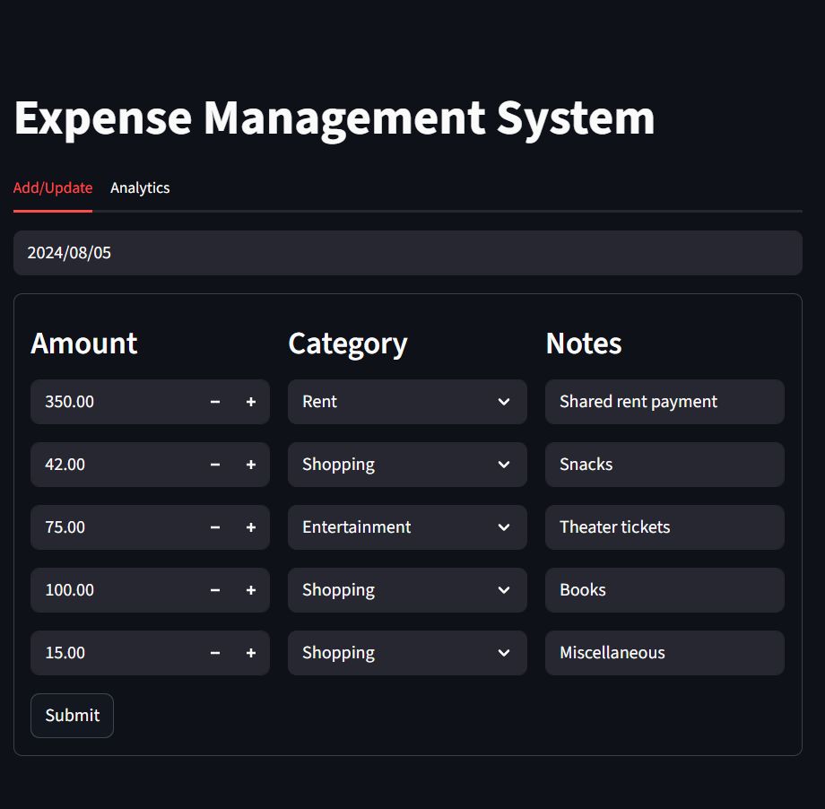
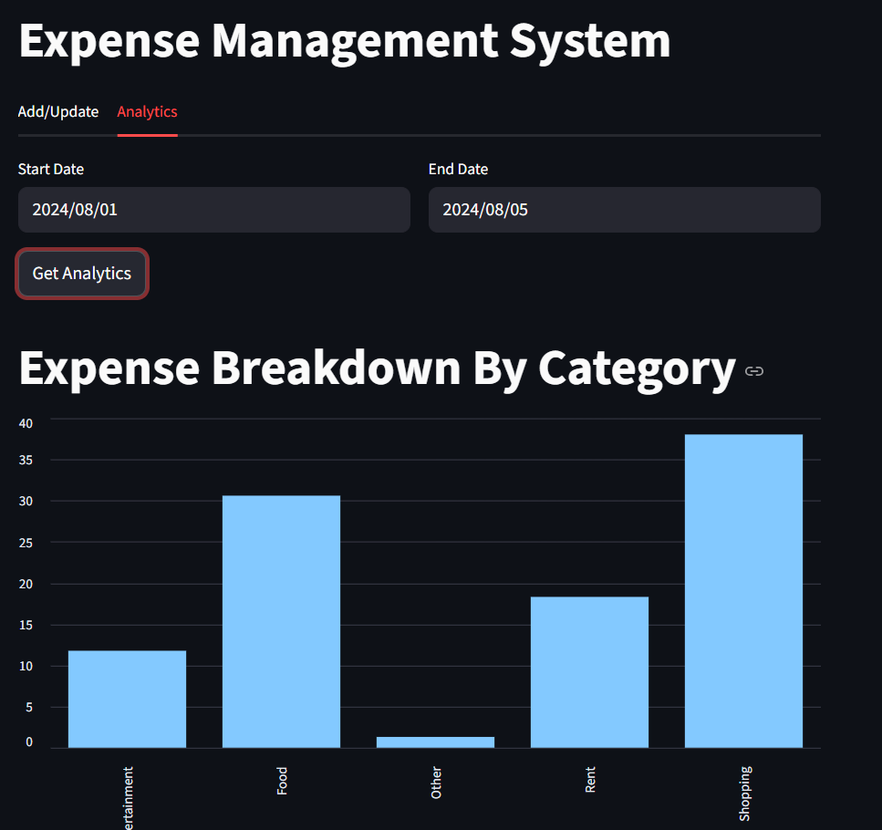
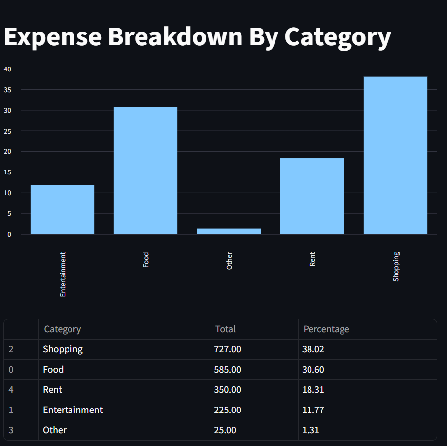

# Expense Tracking System 💰

A full-stack expense management application built using **Python, Streamlit, FastAPI, and MySQL**. The application allows users to manage expenses and visualize spending patterns through an interactive analytics dashboard.

## Features

- **Expense Management:** Add, update, and manage expense records.
- **Expense Analytics:** Analyze expenses by category and date range.
- **Interactive Dashboard:** Visualize spending patterns through charts and summaries.
- **REST API:** Handle backend operations using FastAPI.
- **MySQL Database:** Store and retrieve expense records.
- **Logging:** Record application activity and errors for debugging.
- **Automated Testing:** Separate test directories for frontend and backend components.

## Tech Stack

| Technology | Purpose |
|---|---|
| Python | Application logic |
| Streamlit | Frontend and interactive dashboard |
| FastAPI | Backend REST API |
| MySQL | Database |
| MySQL Connector/Python | Database connectivity |
| Uvicorn | ASGI server |
| Pytest | Automated testing |
| Git and GitHub | Version control |

## Project Structure

```text
Project Expense Tracking System/
├── Backend/
│   ├── db_helper.py
│   ├── logging_setup.py
│   └── server.py
├── Frontend/
│   ├── app.py
│   ├── add_update_ui.py
│   └── analytics_ui.py
├── Test/
│   ├── backend/
│   ├── frontend/
│   └── conftest.py
├── .gitignore
├── requirements.txt
└── README.md
```

## Prerequisites

Before running the application, install:

- Python 3.10 or a compatible version
- MySQL Server
- Git

## Installation and Setup

### 1. Clone the Repository

```bash
git clone <YOUR_GITHUB_REPOSITORY_URL>
cd "Project Expense Tracking System"
```

Replace `<YOUR_GITHUB_REPOSITORY_URL>` with your actual GitHub repository URL.

### 2. Create a Virtual Environment

On Windows PowerShell:

```powershell
python -m venv .venv
.\.venv\Scripts\Activate.ps1
```

### 3. Install Dependencies

```powershell
python -m pip install -r requirements.txt
```

### 4. Configure the MySQL Database

Make sure your MySQL server is running. Create the database if it does not already exist:

```sql
CREATE DATABASE expense_manager;
```

Create the tables required by the application using your database schema or initialization script.

Configure your database connection using PowerShell environment variables:

```powershell
$env:DB_HOST = "localhost"
$env:DB_USER = "root"
$env:DB_PASSWORD = "YOUR_MYSQL_PASSWORD"
$env:DB_NAME = "expense_manager"
```

Replace `YOUR_MYSQL_PASSWORD` with your local MySQL password.

**Security:** Never commit actual passwords or database credentials to GitHub. These environment variables apply only to the current terminal session.

### 5. Start the Backend Server

Open a terminal at the project root, activate the virtual environment, and configure the database environment variables.

Run:

```powershell
uvicorn Backend.server:app --reload --port 8000
```

The FastAPI backend will run at:

- API: http://127.0.0.1:8000
- Interactive API documentation: http://127.0.0.1:8000/docs

Keep this terminal running.

### 6. Start the Frontend Application

Open a second terminal at the project root, activate the virtual environment, and configure the database environment variables if required by the frontend.

Run:

```powershell
streamlit run .\Frontend\app.py
```

Open the local URL displayed in the terminal to access the application.

## Running Tests

Run the test suite from the project root:

```powershell
python -m pytest
```

To display detailed test results:

```powershell
python -m pytest -v
```

## Application Screenshots

### 1. Expense Tracking Dashboard


### 2. Expense Tracking With Graph


### 3. Expense Tracking With Table


## Author

**Abhishek Vats**

- GitHub: [@vatsabhishek66-arch](https://github.com/vatsabhishek66-arch)

---

Built with Python, Streamlit, FastAPI, and MySQL.